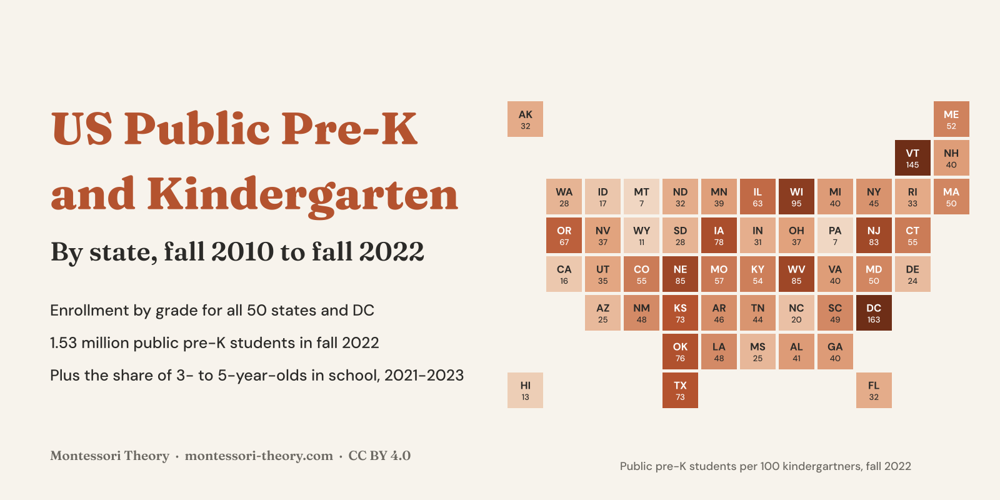
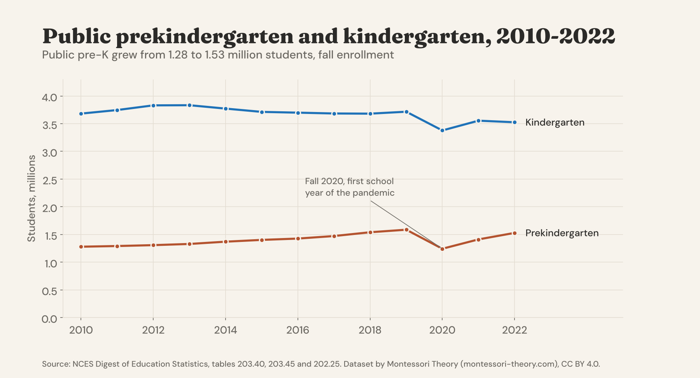
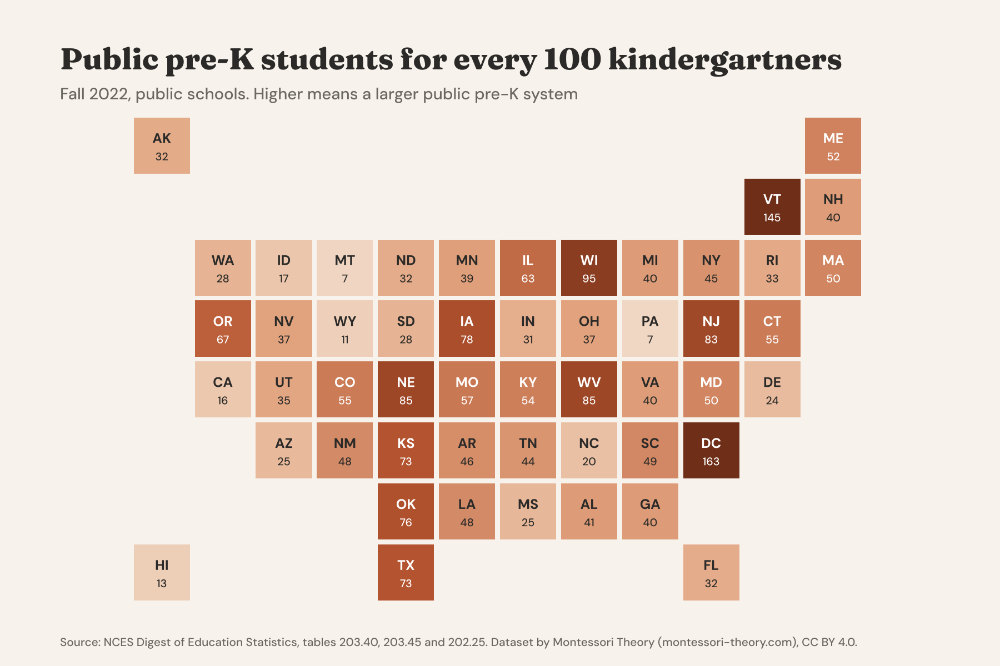
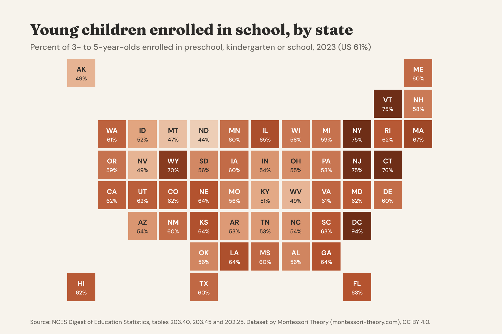
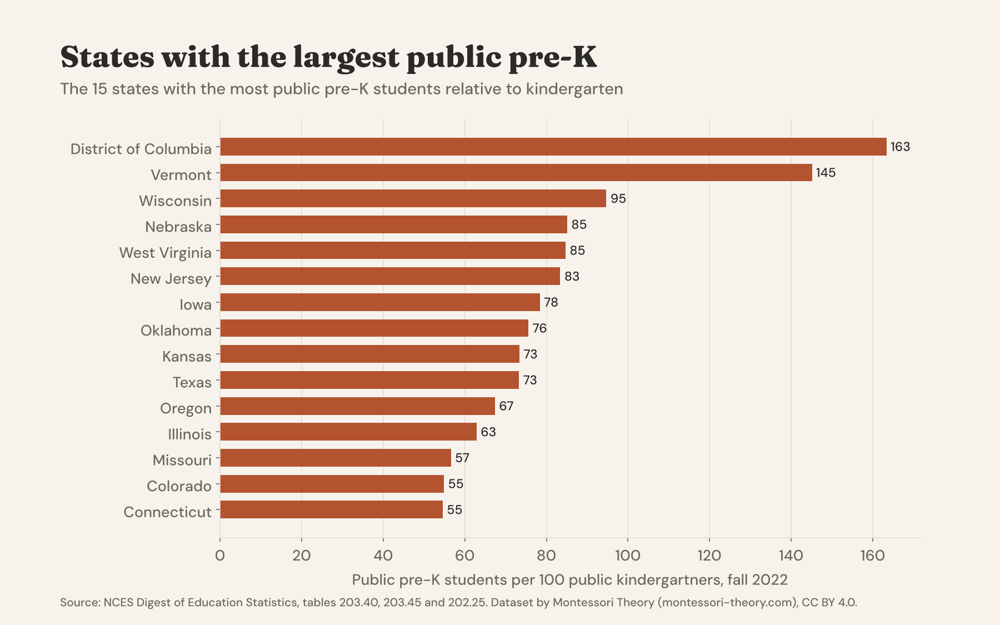

# US Public Pre-K and Kindergarten Enrollment by State, 2010-2022

[](https://creativecommons.org/licenses/by/4.0/) [](https://www.kaggle.com/datasets/mariamontessori/us-public-prek-kindergarten) [](https://huggingface.co/datasets/montessoritheory/us-public-prek-kindergarten)



**English first, version française plus bas, resumen en español al final.**

## How Many Children Start School Early, State By State

Public pre-K has become one of the biggest changes in American early education, but it looks very different from one state to the next. This dataset gathers the official public school enrollment counts by grade for **all 50 states and DC, every fall from 2010 to 2022**, from the NCES Common Core of Data as published in 13 editions of the Digest of Education Statistics, into one tidy table. It adds ready-made indicators for prekindergarten and kindergarten and the **share of 3- to 5-year-olds enrolled in school** in each state from the Census Bureau's American Community Survey, 2021 to 2023.

Public **prekindergarten grew from 1.28 million students in fall 2010 to 1.59 million in fall 2019**, fell to 1.24 million in fall 2020, the first school year of the pandemic, and was back to **1.53 million in fall 2022**. Over the same years public kindergarten shrank from 3.68 to 3.53 million, so there are now **43 public pre-K students for every 100 kindergartners**, against 35 in 2010.

### The Headline Numbers

|  |  |
|---|---|
| Public prekindergarten, fall 2022 | 1,528,198 students |
| Public kindergarten, fall 2022 | 3,525,725 students |
| Pre-K students per 100 kindergartners | 34.7 in 2010, 42.7 in 2019, 36.8 in 2020, 43.3 in 2022 |
| Largest public pre-K | Texas 269,441, New York 76,715, Illinois 76,302, New Jersey 71,749 |
| Most pre-K relative to kindergarten | DC 163, Vermont 145, Wisconsin 95, Nebraska 85, West Virginia 85 per 100 |
| Least | Pennsylvania 7, Montana 7, Wyoming 11, Hawaii 13, California 16 per 100 |
| Fastest growth since fall 2012 | Nevada +158 %, Alabama +157 %, Indiana +150 % |
| 3- to 5-year-olds enrolled in school, US | 53.3 % in 2021, 59.0 % in 2022, 61.0 % in 2023 |
| Highest and lowest, 2023 | DC 94 %, Connecticut 76 %, Vermont 75 % · North Dakota 44 %, Montana 47 % |









### Files

| file | content |
|---|---|
| `data/public_enrollment_by_state_and_grade_2010_2022.csv` | 676 rows, one per state and fall (51 states and DC plus the US total, 13 falls), enrollment in pre-K, kindergarten, each grade 1 to 12 and all grades |
| `data/prek_and_kindergarten_by_state.csv` | pre-K and kindergarten with pre-K per 100 kindergartners, share of enrollment and change since 2012 |
| `data/national_prek_kindergarten.csv` | 13 rows, the national series |
| `data/children_3_to_5_enrolled_by_state_2021_2023.csv` | percent of 3- to 5-year-olds enrolled in school by state, with standard errors |
| `data_dictionary.csv` | every column of every file |
| `scripts/` | the code that rebuilds everything from the NCES tables |
| `notebooks/starter.ipynb` | a starter notebook with the charts above |

### Columns

**public_enrollment_by_state_and_grade_2010_2022.csv**

| column | description |
|---|---|
| `fall_year` | Fall of the school year (2022 = school year 2022-23) |
| `state`, `state_abbr` | State name and postal code, US for the national total |
| `total_all_grades` | Public enrollment, all grades including ungraded |
| `prekindergarten`, `kindergarten` | Public pre-K and kindergarten enrollment |
| `grade_1` ... `grade_12` | Public enrollment in each grade |
| `source_note` | NCES footnote on the pre-K figure, for example imputed or estimated values |
| `source_table` | Digest edition and table the row comes from |

**children_3_to_5_enrolled_by_state_2021_2023.csv**: `year`, `state`, `state_abbr`, `age_group`, `percent_enrolled_in_school`, `standard_error`, `source_table`.

### Load It

```python
import pandas as pd

base = "https://raw.githubusercontent.com/montessoritheory/us-public-prek-kindergarten/main/data"
pk = pd.read_csv(f"{base}/prek_and_kindergarten_by_state.csv")
pk[pk.fall_year == 2022].sort_values("prek_per_100_kindergartners", ascending=False).head(10)
```

### How It Was Built

NCES publishes public enrollment by grade and state each year in table 203.40 of the Digest of Education Statistics, and the previous fall in table 203.45. The Excel files of both tables were downloaded for the Digest editions 2013 to 2023 in November 2026, which cover the falls 2010 to 2022. Each file was parsed with its own header layout, footnote markers were turned into their text, and when two editions report the same fall the most recent edition was kept, since NCES revises earlier counts. Table 202.25 of the Digest editions 2022 to 2024 gives the share of 3- to 5-year-olds enrolled in school by state from the American Community Survey. `scripts/build.py` builds the tables and `scripts/make_outputs.py` the charts.

### Checked Against The Source

- **States add up to the nation.** For every fall from 2010 to 2022, the 50 states and DC add up exactly to the US total for pre-K, kindergarten and all grades.
- **Published totals.** The national figures match the Digest, for example 1,528,198 public pre-K and 49,618,464 students in all grades in fall 2022 ([table 203.40, Digest 2023](https://nces.ed.gov/programs/digest/d23/tables/dt23_203.40.asp)).

### Read With Care

- **Public schools only.** These are students enrolled in public schools. State-funded pre-K delivered by private centers, Head Start and private preschools is not counted, which is why states such as Florida or Georgia, with large voucher or mixed-delivery programs, show fewer public pre-K students than their program size suggests.
- **Pre-K means different ages.** Some states and DC count both 3- and 4-year-olds in public pre-K, which is how DC and Vermont exceed 100 pre-K students per 100 kindergartners. The ratio compares system sizes, not the share of children served.
- **Imputed values.** NCES imputed or estimated the pre-K count of some states in some years (California and Oregon in several falls). The `source_note` column says when.
- **Fall 2020.** The drop in fall 2020 reflects the first pandemic school year, when many families delayed pre-K and kindergarten.
- **Survey estimates for 3 to 5.** The share of 3- to 5-year-olds in school comes from a sample survey and includes private programs and kindergarten. Use the standard errors when comparing states.
- Kindergarten is where Montessori's 3 to 6 cycle ends. Our guide to the [Montessori kindergarten year](https://www.montessori-theory.com/montessori-kindergarten-approach/) explains why many families keep their child in the same class for it.

### License And Citation

**[CC BY 4.0](https://creativecommons.org/licenses/by/4.0/)**. Use it, share it and adapt it, commercially or not, and credit **Montessori Theory** with a link to **[montessori-theory.com](https://www.montessori-theory.com/)**, along with the original sources below.

```bibtex
@misc{montessoritheory_us_public_prek_kindergarten_2026,
  title  = {US Public Pre-K and Kindergarten Enrollment by State, 2010-2022},
  author = {Carter, Sophia and {Montessori Theory}},
  year   = {2026},
  url    = {https://github.com/montessoritheory/us-public-prek-kindergarten},
  note   = {Dataset, version 1.0, built from NCES Digest of Education Statistics tables 203.40, 203.45 and 202.25}
}
```

Sources. U.S. Department of Education, National Center for Education Statistics, [Digest of Education Statistics](https://nces.ed.gov/programs/digest/), tables 203.40 and 203.45 (Common Core of Data, State Nonfiscal Survey of Public Elementary/Secondary Education), editions 2013 to 2023, and table 202.25 (U.S. Census Bureau, American Community Survey), editions 2022 to 2024. US government works, public domain.

Also on **[Kaggle](https://www.kaggle.com/datasets/mariamontessori/us-public-prek-kindergarten)** and **[Hugging Face](https://huggingface.co/datasets/montessoritheory/us-public-prek-kindergarten)**.

---

## Version Française

### La pré-maternelle et la maternelle publiques par État, 2010-2022

Les effectifs officiels des écoles publiques par niveau, pour les 50 États et Washington DC, chaque automne de 2010 à 2022 (NCES, Common Core of Data), avec des indicateurs prêts à l'emploi pour la pré-maternelle (pre-K) et la maternelle (kindergarten), et la part des enfants de 3 à 5 ans scolarisés par État en 2021-2023.

- La pre-K publique est passée de **1,28 million** d'élèves en 2010 à **1,53 million** en 2022, avec une forte baisse à l'automne 2020.
- Il y a aujourd'hui **43 élèves de pre-K pour 100 élèves de maternelle**, contre 35 en 2010.
- Le Texas compte de loin le plus d'élèves de pre-K publique (269 000).

Licence CC BY 4.0, en citant **Montessori Theory** avec un lien vers **[montessori-theory.com](https://www.montessori-theory.com/)** et la source NCES.

### 🇪🇸 Resumen

La matrícula oficial de pre-K y kindergarten en escuelas públicas de los 50 estados y DC, cada otoño de 2010 a 2022 (NCES), y el porcentaje de niños de 3 a 5 años escolarizados por estado, 2021-2023. Licencia CC BY 4.0.

---

**Part of [Montessori Open Data](https://github.com/montessoritheory/montessori-open-data)**, documented open datasets on Montessori schools and early childhood, by [Montessori Theory](https://www.montessori-theory.com/).
